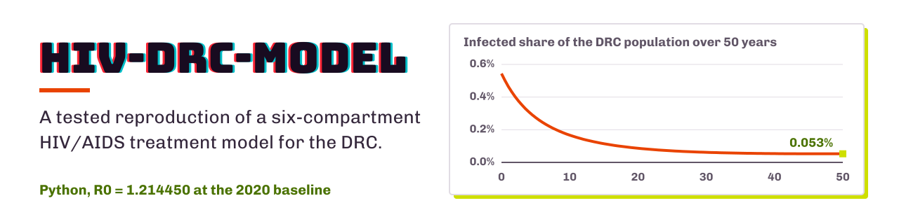
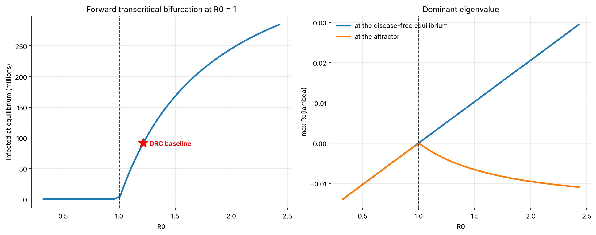
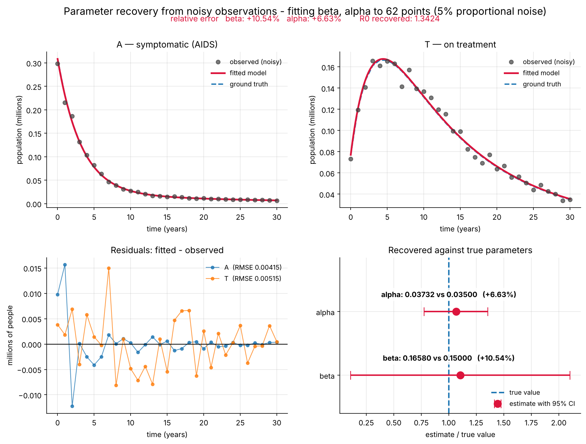
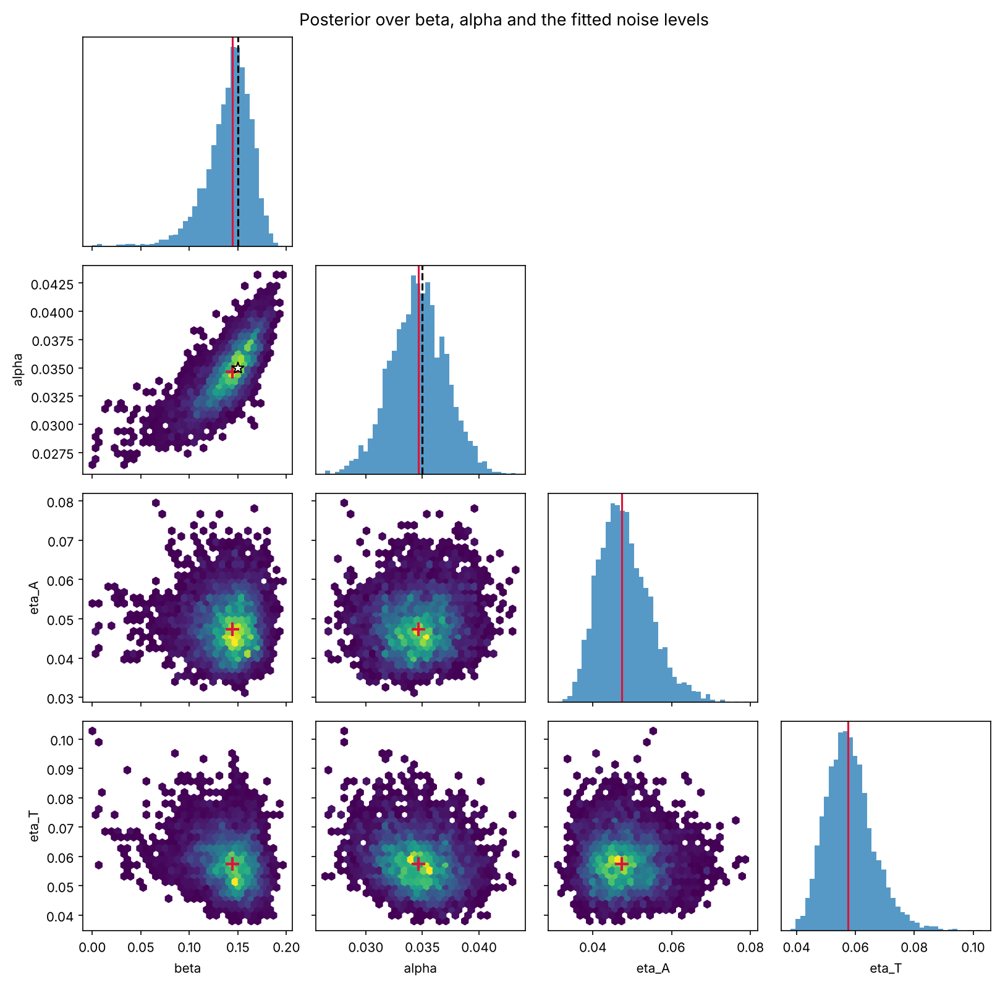
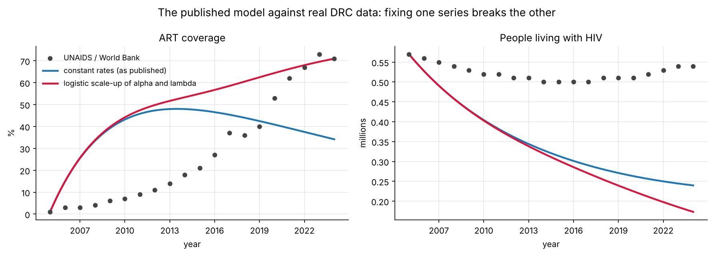

<p align="center">
  <picture><source media="(prefers-color-scheme: dark)" srcset="assets/banner-dark.svg"></picture>
</p>

# Hiv-Drc-Model

**English** · [繁體中文](README.zh-TW.md)

> HIV/AIDS transmission dynamics with treatment: the DRC case, reproduced and then run backwards.

[](https://www.python.org/)
[](LICENSE)
[](https://github.com/heinricitorgau/hiv-drc-model/actions/workflows/ci.yml)
[](https://doi.org/10.5556/j.tkjm.57.5817.2026)
[](https://colab.research.google.com/github/heinricitorgau/hiv-drc-model/blob/main/notebooks/01_inverse_problem.ipynb)

A complete, tested reproduction of the six-compartment HIV/AIDS treatment model of

> C. K. Mbayi, J.-M. N. Mpompi and J. B. Munyakazi,
> *A model of HIV/AIDS transmission dynamics with treatment: The case of the DRC*,
> **Tamkang Journal of Mathematics** 57(2), 149–169 (2026).
> [doi:10.5556/j.tkjm.57.5817.2026](https://doi.org/10.5556/j.tkjm.57.5817.2026)

The paper solves the forward problem: rates in, trajectories out. But the contact rate $\beta$
and the treatment rate $\alpha$ are not quantities anyone measures. So this package also solves
the **inverse problem** — recover the hidden rates from the noisy numbers a surveillance system
actually publishes — and then points the model at real UNAIDS data to see whether it holds up.
It does not, and the package says so.

---

## Results at a glance

### 1. The paper is reproduced to six digits

$R_0 = 1.214450$ from the closed form and from the spectral radius of $FV^{-1}$, against the
published 1.2145. The local-stability theorem is checked numerically on both sides of the
threshold, where the model shows a forward transcritical bifurcation.

<p align="center"></p>

### 2. Running it backwards recovers the hidden rates

Given only noisy observations of two compartments, bounded nonlinear least squares recovers
$\beta$ and $\alpha$ with 95% intervals that contain the truth — and that achieve 95% coverage
over 40 replicates at 5% noise.

<p align="center"></p>

### 3. The Bayesian answer is tighter, and infers its own noise level

An ensemble MCMC sampler (`emcee`) explores the actual posterior and fits each series'
measurement noise jointly with the epidemiological rates. Against least squares over 20
replicates at 10% noise: the same coverage in 2–4× tighter intervals.

<p align="center"></p>

### 4. Against real data, the published model breaks — measurably

- Table 2 is labelled DRC 2020, but its treatment compartment implies **15.9% ART coverage**
  against UNAIDS's **53%** for that year; 15.9% is the DRC of 2013.
- Fitted over different windows of the same real series, $\alpha$ spans its entire admissible
  range and $R_0$ runs from 0.49 to 6.23 — straddling the very threshold the paper is about.
- Giving the rates a logistic scale-up hits 2024 ART coverage almost exactly (70.9% vs 71%)
  while missing people living with HIV threefold (0.173 M vs 0.540 M).

<p align="center"></p>

That is model misspecification, not a bad optimiser. The [full write-up](docs/REPORT.md#meeting-real-data)
measures it window by window, and the [informative-priors section](docs/REPORT.md#informative-priors-and-whether-they-earned-it)
shows that three of the nine scale-up parameters are echoes of their priors rather than
anything the data determined.

---

## What is inside

- **Six-compartment ODE system** integrated with `solve_ivp`, verified against the
  population-balance identity and cross-checked across three solvers.
- **$R_0$, equilibria and stability**, with a complex-step Jacobian accurate to machine precision.
- **Local and global sensitivity** (normalised indices, Latin hypercube + PRCC).
- **Synthetic data generator** with two Gaussian measurement-error models, so the estimator is
  developed against data whose true answer is known.
- **Least squares and MCMC** for the inverse problem, with intervals, correlation matrices,
  split-$\hat R$ and posterior-predictive checks.
- **Observation operators** for what surveillance actually reports (PLHIV, ART coverage), and a
  measured answer to [which data is worth collecting](docs/REPORT.md#which-data-is-worth-collecting).
- **Real-data ingestion** from a committed UNAIDS/World Bank snapshot, so every fit is reproducible.
- **Time-varying rates**, with the constant-coefficient theory refusing to answer rather than
  misleading once they are switched on.
- **An interactive Streamlit dashboard** that puts all of the above behind sliders.
- **222 tests** (238 with doctests), none of which compares the code to itself.

---

## Quick start

```bash
git clone https://github.com/heinricitorgau/hiv-drc-model.git
cd hiv-drc-model
pip install -e ".[app]"

python -m hiv_drc          # all twelve figures into figures/, about 30 seconds
streamlit run app.py       # the dashboard
```

Or skip the install and open a notebook in Colab:
[the inverse problem](https://colab.research.google.com/github/heinricitorgau/hiv-drc-model/blob/main/notebooks/01_inverse_problem.ipynb) ·
[Bayesian uncertainty](https://colab.research.google.com/github/heinricitorgau/hiv-drc-model/blob/main/notebooks/02_bayesian_uncertainty.ipynb).

---

## Documentation

| | |
| --- | --- |
| [**The full write-up**](docs/REPORT.md) | The model, $R_0$, every result — including the negative ones — and how each is tested |
| [**Installation and usage**](docs/USAGE.md) | Command line, Python API, the dashboard, the twelve output figures, project layout |
| [Notebook 1](notebooks/01_inverse_problem.ipynb) | A narrated walkthrough of the estimation pipeline |
| [Notebook 2](notebooks/02_bayesian_uncertainty.ipynb) | The same fit by MCMC, and where the two methods disagree |
| [Contributing](CONTRIBUTING.md) | How to propose a change, and what counts as a test here |

---

## Citation

If you use this code, please cite the original paper:

```bibtex
@article{Mbayi2026HIVDRC,
  author  = {Mbayi, Charles K. and Mpompi, Jean-Marie N. and Munyakazi, Justin B.},
  title   = {A model of {HIV/AIDS} transmission dynamics with treatment:
             The case of the {DRC}},
  journal = {Tamkang Journal of Mathematics},
  volume  = {57},
  number  = {2},
  pages   = {149--169},
  year    = {2026},
  doi     = {10.5556/j.tkjm.57.5817.2026}
}
```

To cite this implementation as well, use GitHub's **Cite this repository** button, which reads
[`CITATION.cff`](CITATION.cff).

This repository is an independent reproduction. It is not affiliated with the authors, and
any error in the code is the fault of this implementation rather than of the paper.

## License

[MIT](LICENSE). The paper itself remains under its own publisher's terms.
