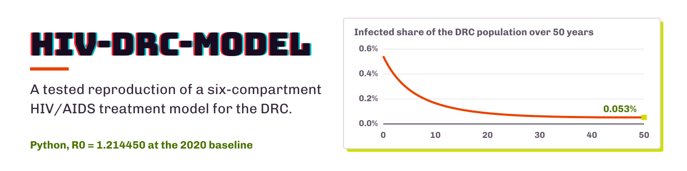

<p align="center">
  <picture><source media="(prefers-color-scheme: dark)" srcset="assets/banner-dark.svg"></picture>
</p>

# Hiv-Drc-Model

[English](README.md) · **繁體中文**

> 含治療的 HIV/AIDS 傳播動態：剛果民主共和國（DRC）案例的完整重現，並把模型倒過來求解。

[](https://www.python.org/)
[](LICENSE)
[](https://github.com/heinricitorgau/hiv-drc-model/actions/workflows/ci.yml)
[](https://doi.org/10.5556/j.tkjm.57.5817.2026)

這是下面這篇論文中六倉室 HIV/AIDS 治療模型的完整、有測試的重現：

> C. K. Mbayi, J.-M. N. Mpompi and J. B. Munyakazi,
> *A model of HIV/AIDS transmission dynamics with treatment: The case of the DRC*,
> **Tamkang Journal of Mathematics** 57(2), 149–169 (2026).
> [doi:10.5556/j.tkjm.57.5817.2026](https://doi.org/10.5556/j.tkjm.57.5817.2026)

這個套件把論文發表的基本再生數重現到小數點後六位，在閾值兩側以數值方式驗證論文的局部穩定性定理，並加上原論文沒有的全域敏感度分析。

**接著它把模型倒過來跑。** 論文解的是正向問題：輸入速率，輸出軌跡。但 $\beta$ 和 $\alpha$ 不是任何人量得到的量，沒有人在數接觸次數。所以這個套件也解**反問題**：只給定監測系統實際看得到的兩個倉室的含噪觀測，找回產生這些觀測的隱藏速率。

- **六倉室 ODE 系統**，用 `solve_ivp` 積分，以人口守恆恆等式驗證，並在三種求解器之間交叉比對。
- **合成資料產生器**，有兩種高斯量測誤差模型，讓估計器在已知正確答案的資料上開發。
- **有界非線性最小平方法**（`scipy.optimize.least_squares`，trust-region reflective），每個序列各自加權殘差、多起點全域搜尋，並由求解器的 Jacobian 給出漸近信賴區間。
- **誠實的不確定性。** 擬合結果會同時報告它能確定和不能確定的部分：95% 區間、參數相關矩陣，以及目標函數地形圖。在 5% 噪音下重複 40 次，區間達到 95% 的覆蓋率。
- **貝氏不確定性量化。** 系集 MCMC 取樣器（`emcee`）探索真正的後驗分布，而不是它的局部二次近似；每個序列自己的量測噪音水準和流行病學速率一起推論，而不是用猜的。在 10% 噪音下重複 20 次，與最小平方法的區間相比：覆蓋率相同，區間窄 2 到 4 倍，而且在頻率學派標準誤爆成 `inf` 的那次也沒有退化的輸出。
- **觀測算子**，把模型狀態對應到監測系統實際發布的數字（HIV 感染者人數、ART 覆蓋率），因為沒有任何衛生系統會報告「目前在有症狀倉室的人數」；並實際量測哪些資料值得收集。
- **真實資料匯入**，取自 UNAIDS／世界銀行的估計值，並誠實報告論文模型遇上這些資料時的結果：它無法在治療擴大期間被校準，而且論文發表的初始條件和論文發表的資料互相矛盾。
- **隨時間變化的速率**，用於治療與診斷計畫；一旦啟用，常係數理論會拒絕回答，而不是給出誤導的答案。
- **資訊性先驗與收縮診斷**，因為緊的先驗一定會產生緊的後驗；擬合結果會報告每個區間有多少是資料真正貢獻的，結果九個擴大期參數中有三個只是先驗的回音。
- **222 個測試**，沒有一個是拿程式碼和它自己比較。

---

## 目錄

- [模型](#模型)
- [基本再生數](#基本再生數)
- [安裝](#安裝)
- [使用方式](#使用方式)
- [輸出圖表](#輸出圖表)
- [結果](#結果)
- [反問題](#反問題)
- [實際上能觀測到什麼](#實際上能觀測到什麼)
- [面對真實資料](#面對真實資料)
- [隨時間變化的速率](#隨時間變化的速率)
- [資訊性先驗](#資訊性先驗以及它們是否名副其實)
- [貝氏不確定性](#貝氏不確定性)
- [測試與驗證](#測試與驗證)
- [專案結構](#專案結構)
- [引用](#引用)
- [授權](#授權)

---

## 模型

六個倉室，全部以**百萬人**為單位，時間以**年**為單位。

| 符號 | 倉室 | 說明 |
| --- | --- | --- |
| $S$ | 易感者 | 有風險，未感染 |
| $I_1$ | 感染者，不知情 | 無症狀，本人不知道自己的感染狀態 |
| $I_2$ | 感染者，已知情 | 無症狀，已確診 |
| $A$ | 有症狀 | 已進展到 AIDS |
| $T$ | 治療中 | 正在接受抗反轉錄病毒治療 |
| $R$ | 行為改變者 | 因採取保護行為而離開易感族群 |

令總人口 $N = S + I_1 + I_2 + A + T + R$，系統為

$$
\begin{aligned}
\frac{dS}{dt}   &= \Lambda - \frac{\beta S}{N}\left(I_1 + cI_2 + dA\right) - \mu S - \phi S \\[4pt]
\frac{dI_1}{dt} &= \frac{\beta S}{N}\left(I_1 + cI_2 + dA\right) - \left(\sigma_1 + \lambda + \mu\right) I_1 \\[4pt]
\frac{dI_2}{dt} &= \lambda I_1 - \left(\sigma_2 + \mu + \alpha\right) I_2 + \kappa_2 T \\[4pt]
\frac{dA}{dt}   &= \sigma_1 I_1 + \sigma_2 I_2 - \left(\mu + \delta_1 + \kappa_1\right) A \\[4pt]
\frac{dT}{dt}   &= \alpha I_2 + \kappa_1 A - \left(\kappa_2 + \mu + \delta_2\right) T \\[4pt]
\frac{dR}{dt}   &= \phi S - \mu R
\end{aligned}
$$

在看結果之前，有三個特點值得先指出。

**傳播主要由未確診者驅動。** 三個感染類別都會傳播，但 $I_2$ 和 $A$ 的相對傳染力較低，分別是 $c = 0.03$ 和 $d = 0.001$。因此診斷本身就被建模成一種介入，與治療無關。

**治療不是吸收態。** $\kappa_2 T$ 項讓人從 $T$ 回到 $I_2$，代表治療中斷或失敗。正是這個回饋迴路，讓地方性平衡點無法寫成封閉形式。

**人口不是常數。** 把六個方程式相加得到

$$\frac{dN}{dt} = \Lambda - \mu N - \delta_1 A - \delta_2 T,$$

所以 $N(t)$ 的上界是承載量 $\Lambda/\mu = 531.69$ 百萬，但可以自由往上界成長。測試套件會檢查這個恆等式；要抓出某一項離開一個倉室卻沒進入另一個倉室的錯誤，這是最快的方法。

### 基準參數（DRC，2020 年）

取自論文的表 3。所有速率都以每年為單位；$c$ 和 $d$ 無因次。

| 參數 | 符號 | 數值 | 意義 |
| --- | --- | --- | --- |
| `Lambda` | $\Lambda$ | 8.8261 | 進入 $S$ 的補充率（百萬人／年） |
| `beta` | $\beta$ | 0.15 | 有效接觸率 |
| `mu` | $\mu$ | 0.0166 | 自然死亡率 |
| `phi` | $\phi$ | 0.083 | 採取保護行為的速率 |
| `c` | $c$ | 0.03 | $I_2$ 的相對傳染力 |
| `d` | $d$ | 0.001 | $A$ 的相對傳染力 |
| `sigma1` | $\sigma_1$ | 0.0025 | 進展 $I_1 \to A$ |
| `sigma2` | $\sigma_2$ | 0.06 | 進展 $I_2 \to A$ |
| `lam` | $\lambda$ | 0.0015 | 診斷 $I_1 \to I_2$ |
| `delta1` | $\delta_1$ | 0.0909 | $A$ 的疾病致死率 |
| `delta2` | $\delta_2$ | 0.0667 | 治療中的疾病致死率 |
| `alpha` | $\alpha$ | 0.035 | 開始治療 $I_2 \to T$ |
| `kappa1` | $\kappa_1$ | 0.2 | 開始治療 $A \to T$ |
| `kappa2` | $\kappa_2$ | 0.04 | 回流 $T \to I_2$ |

初始條件取自表 2，單位為百萬：
$S(0) = 88.516$，$I_1(0) = 0.014$，$I_2(0) = 0.0846$，$A(0) = 0.30832$，$T(0) = 0.07708$，$R(0) = 0$。

---

## 基本再生數

令 $a_1 = \sigma_1 + \lambda + \mu$、$a_2 = \sigma_2 + \mu + \alpha$、
$a_3 = \mu + \delta_1 + \kappa_1$、$a_4 = \kappa_2 + \mu + \delta_2$，以及
$D = a_1\left(a_2a_3a_4 - \kappa_1\kappa_2\sigma_2 - \alpha\kappa_2 a_3\right)$，論文的次世代矩陣計算給出

$$R_0 = \frac{\beta\mu}{\mu + \phi}\left(R_1 + R_2 + R_3\right),$$

$$
R_1 = \frac{1}{a_1}, \qquad
R_2 = \frac{c\left(\lambda a_3 a_4 + \kappa_1\kappa_2\sigma_1\right)}{D}, \qquad
R_3 = \frac{d\left(a_4\left(\sigma_1\sigma_2 + \mu\sigma_1 + \lambda\sigma_2\right) + \alpha\sigma_1\left(\mu + \delta_2\right)\right)}{D}.
$$

每一項是一個傳染類別的貢獻，而前面的因子 $\mu/(\mu+\phi)$ 是無病平衡點的易感比例 $S^*/N^*$，行為改變 $\phi$ 就是從這裡進入的。

這個套件實作了封閉形式，**也**獨立組出次世代矩陣 $F$ 和 $V$，再取 $FV^{-1}$ 的譜半徑。兩者在十二位有效數字內一致，測試套件要求它們在數百組隨機擾動的參數下持續一致。沒有這第二條路，代數裡的一個筆誤就會靜悄悄地傳進 repo 裡的每一張圖。

---

## 安裝

需要 Python 3.10 或更新版本。

```bash
git clone https://github.com/heinricitorgau/hiv-drc-model.git
cd hiv-drc-model
python -m venv .venv
source .venv/bin/activate        # Windows: .venv\Scripts\activate
pip install -e .
```

或者不安裝套件，只裝相依套件（這個檔案是 pyproject 的鏡像，留給從 requirements 檔安裝的部署環境）：

```bash
pip install -r requirements.txt
```

開發用（加上 pytest 和 ruff）：

```bash
pip install -e ".[dev]"
```

[互動式儀表板](#互動式儀表板)用（加上 streamlit）：

```bash
pip install -e ".[app]"
```

相依套件只有 `numpy`、`scipy`、`matplotlib` 和 `emcee`。Streamlit 只有 `app.py` 需要，放在 `app` extra 裡，所以 import `hiv_drc` 永遠不會順帶載入網頁框架。

---

## 使用方式

### 命令列

執行全部流程，並把十二張圖寫進 `figures/`：

```bash
python -m hiv_drc
```

六個階段分別是 `dynamics`、`r0`、`stability`、`sensitivity`、`estimate` 和 `bayes`，可以用名稱只選其中幾個：

```bash
python -m hiv_drc dynamics
```

```bash
python -m hiv_drc r0 stability
```

產生含噪資料，再從資料中找回參數：

```bash
python -m hiv_drc estimate --noise 0.05 --starts 8 --data data/synthetic/observations.csv
```

不求點估計，改為對後驗分布取樣：

```bash
python -m hiv_drc bayes --noise 0.05 --mcmc-walkers 16 --mcmc-steps 1000
```

常用選項：

| 旗標 | 預設值 | 作用 |
| --- | --- | --- |
| `--outdir DIR` | `figures` | PNG 的輸出位置 |
| `--years N` | `50` | 動態模擬的時間長度 |
| `--samples N` | `1000` | 拉丁超立方取樣的樣本數 |
| `--spread F` | `0.25` | 取樣範圍的相對半寬 |
| `--sweep-points N` | `41` | 分岔掃描的點數 |
| `--show` | 關閉 | 以互動方式開啟圖表，而不只是存檔 |
| `--no-save` | 關閉 | 不寫出 PNG |

`estimate` 階段的選項：

| 旗標 | 預設值 | 作用 |
| --- | --- | --- |
| `--fit PARAM...` | `beta alpha` | 要找回哪些參數 |
| `--noise F` | `0.05` | 合成資料的相對量測噪音 |
| `--noise-model M` | `proportional` | `proportional`（比例）或 `constant`（固定）量測誤差 |
| `--obs-years N` | `30` | 觀測期間的長度 |
| `--obs-points N` | `31` | 觀測點數 |
| `--seed N` | `20260830` | 噪音與多起點抽樣的亂數種子 |
| `--starts N` | `8` | 最佳化器的多起點重啟次數 |
| `--weights W` | `scale` | 殘差加權方式：`scale`、`sigma` 或 `none` |
| `--grid N` | `41` | 目標函數曲面網格的解析度 |
| `--data PATH` | 無 | 把合成觀測寫進這個 CSV |

`bayes` 階段的選項（另外也使用上面與 `estimate` 共用的 `--fit`、`--noise`、`--noise-model`、`--obs-years`、`--obs-points` 和 `--seed`）：

| 旗標 | 預設值 | 作用 |
| --- | --- | --- |
| `--mcmc-walkers N` | `16` | MCMC 取樣器的系集大小 |
| `--mcmc-steps N` | `1000` | 每個 walker 的步數 |
| `--mcmc-burn N` | `250` | 當作 burn-in 捨棄的步數 |

用預設值大約會跑 16,000 次正向模型；依機器不同，需要幾十秒到幾分鐘。

執行 `pip install -e .` 之後，同樣的功能也可以用 console script 呼叫：

```bash
hiv-drc --samples 2000 --outdir results
```

### 當作函式庫使用

```python
from hiv_drc import DRC_2020, reproduction_number, simulate

result = reproduction_number(DRC_2020)
print(result)                      # R0 = 1.214450 (R1 = 48.543689, ...)

solution = simulate(DRC_2020, t_span=(0.0, 50.0))
print(solution["I1"][-1])          # t = 50 時不知情的感染者
print(solution.prevalence[-1])     # 感染者占總人口的比例
```

參數是不可變的 dataclass，所以情境是用複製而不是修改來建立：

```python
from hiv_drc import critical_beta, endemic_equilibrium

intervention = DRC_2020.replace(phi=0.09, alpha=0.05, sigma1=0.0125)
print(reproduction_number(intervention).R0)     # 0.7644，低於閾值

print(critical_beta(DRC_2020))                  # 0.123513

equilibrium = endemic_equilibrium(DRC_2020)
print(equilibrium.infected, equilibrium.is_stable)
```

從資料找回參數只要三行：

```python
from hiv_drc import generate_observations, estimate_parameters

observations = generate_observations(noise=0.05, seed=20260830)   # 或 Observations.from_csv
fit = estimate_parameters(observations, fit=("beta", "alpha"))
print(fit.summary())
```

```
  param        estimate     std err                     95% CI      truth      error   rel err
  beta         0.165803    0.074724   [  0.016333,   0.315274]   0.150000  +0.015803   +10.54%
  alpha        0.037321    0.005075   [  0.027170,   0.047473]   0.035000  +0.002321    +6.63%

  cost = 1.648974e-01   RMSE (millions)   A: 0.004153   T: 0.005151
  R0 at the estimate = 1.342384
  corr(beta, alpha) = +0.1184
```

改成對後驗取樣只要再多一行，而它回答的是另一個問題：不是「最佳擬合是什麼」，而是「資料實際排除了哪些可能」：

```python
from hiv_drc import run_mcmc

posterior = run_mcmc(observations, fit=("beta", "alpha"), n_walkers=16, n_steps=600, burn=150)
print(posterior.summary())
```

```
  param            median         std                     95% CI   R-hat      ESS
  beta           0.145171    0.021042   [  0.095625,   0.175486]   1.162      n/a   truth 0.150000  (-3.22%)
  alpha          0.034575    0.002350   [  0.030047,   0.039226]   1.146      n/a   truth 0.035000  (-1.22%)
  eta_A          0.046998    0.006543   [  0.037134,   0.062503]   1.109      n/a
  eta_T          0.056340    0.007368   [  0.044648,   0.074339]   1.157      n/a

  acceptance fraction 0.587   16 walkers x 600 steps (150 discarded as burn-in)
  R0 at the posterior median = 1.175355
```

`eta_A` 和 `eta_T` 不是流行病學參數，而是每個序列自己推論出的相對量測噪音水準，是一起擬合出來的，不是假設的。

### 互動式儀表板

`app.py` 把模型放進瀏覽器介面，不用寫程式就能探索各種情境：

```bash
pip install -e ".[app]"
streamlit run app.py
```

共有三個分頁。**Dynamics** 用滑桿調整 $\beta$、$\alpha$ 和 $\phi$，每次變動都用封閉形式重算 $R_0$，並顯示它的 $R_1/R_2/R_3$ 分解，以及 $I_1$、$I_2$、$A$、$T$ 的軌跡。**The inverse problem** 用目前的參數產生含噪的 $A$ 和 $T$，用 `estimate_parameters` 找回參數，並把 Wald 區間和估計器從沒看過的真值放在一起比較。**Real data and the scale-up** 完全不用合成資料：它用 `load_worldbank` 載入 UNAIDS 序列，用第一年的 PLHIV、ART 覆蓋率和人口建立初始狀態（而不是用表 2），再把發布的 `plhiv` 和 `art_coverage` 畫在模型旁邊。

第三個分頁就是設計來切換的。在常數速率下，模型到 2024 年只達到 34% 的 ART 覆蓋率，而發布值是 71%，因為常數的 $\alpha$ 畫不出 S 形曲線。打開 logistic 擴大、滑桿維持預設值，覆蓋率落在 70.9%，但 PLHIV 是 0.173 百萬，而發布值是 0.540。一個序列準到零點一個百分點、另一個卻差了三倍，這正是[面對真實資料](#面對真實資料)整節的重點，只要勾一個核取方塊就看得到。

儀表板本身不計算任何東西：螢幕上每個數字都來自 `DRC_2020`、`simulate`、`reproduction_number`、`generate_observations` 和 `estimate_parameters`。它只是一個檢視，不是第二套實作，所以不會和有測試的那一套漸漸不一致。

有安裝 CJK 字型時，圖表用中文標示，沒有時用英文。matplotlib 遇到缺字不會報錯，而是畫出空白方框，所以在精簡的 Linux 容器上，每個標籤都會靜悄悄地變成方框。

$S$ 和 $R$ 預設隱藏，而不是畫在第二個縱軸上：$S$ 約 88 百萬，$A$ 約 0.05 百萬，同一張圖上兩種縱軸刻度會讓斜率無法比較。勾選核取方塊會把它們加成共用時間軸的第二個面板。

參數選單值得試試預設以外的選項。在滑桿的基準值和 5% 噪音下，擬合 $\beta$ 和 $\alpha$ 能找回到 +10.5% 和 +6.6%，cost 為 0.1649。在同一次擬合中加入 $\phi$，cost 變成 0.1642，幾乎沒變，但 $\beta$ 變成 $1.00 \pm 21.5$，$\phi$ 撞到上界變成 $1.00 \pm 23.7$，兩個區間都跨過零。殘差幾乎沒察覺，參數卻已經失去意義。這就是擴大期研究遇到的[同一種不可識別性](#但九參數模型無法識別)，從下拉選單就能看到；這也是為什麼估計值旁邊總是附上相關係數和標準誤，而不是只給點估計。

---

## 輸出圖表

十二張圖都寫進 `figures/`（被 git 忽略，一個指令就能重新產生）。

| 檔案 | 內容 |
| --- | --- |
| `01_population_dynamics.png` | 四個面板：未感染倉室（$S$、$R$）、感染倉室（$I_1$、$I_2$、$A$、$T$）、總人口對照承載量，以及盛行率。$S$ 和 $R$ 與感染類別分開畫，因為兩者差了三個數量級。 |
| `02_scenarios.png` | 基準情境、提高接觸率（$\beta = 0.2$）以及論文的加強介入情境下的總感染人口，各自標上 $R_0$。 |
| `03_r0_surface.png` | $(\beta, \sigma_1)$ 平面上的 $R_0$。左：填色等高線，標出 $R_0 = 1$ 閾值和 DRC 的現況點。右：同一個曲面的 3D 圖，用半透明的 $R_0 = 1$ 平面切開，交線以黑色畫出。 |
| `04_bifurcation.png` | 地方性感染水準對 $R_0$，以及無病平衡點與吸引子上的主導 Jacobian 特徵值。這是前向跨臨界分岔的圖像。 |
| `05_local_sensitivity.png` | 論文正規化敏感度指標的龍捲風圖。 |
| `06_global_sensitivity.png` | 拉丁超立方／PRCC 篩選：$R_0$ 的 PRCC、全域與局部的比較、50 年感染總數的 PRCC，以及取樣得到的 $R_0$ 分布。 |
| `07_parameter_fit.png` | 反問題：$A$ 和 $T$ 的含噪觀測畫成散點、找回的模型畫成曲線、產生資料的軌跡以虛線畫在底下、殘差，以及每個估計值對照真值與 95% 區間。 |
| `08_cost_surface.png` | $(\beta, \alpha)$ 平面上的目標函數，以對數色階呈現，標出真實參數、最小平方估計和 95% 信賴框。盆地的形狀就是可識別性的診斷。 |
| `09_posterior.png` | $\beta$、$\alpha$ 和兩個擬合噪音水準的兩兩邊際後驗，也就是 MCMC 的「corner plot」。圓形的點雲代表這一對參數可以分別識別；拉長的點雲代表只有它們的某種組合可以識別。 |
| `10_trace.png` | 每個參數的 walker 軌跡：每個 walker 在保留步數內的路徑，並標上它的 split-$\hat R$。模糊的水平帶是混合良好的鏈；明顯分開的 walker 則不是。 |
| `11_posterior_predictive.png` | 觀測到的 $A$ 和 $T$ 對照後驗*預測*帶（模型加上每次抽樣自己擬合的噪音），每個面板都報告實際落在帶內的點所占比例。 |
| `12_bayes_vs_frequentist.png` | 同一次擬合的最小平方 Wald 區間和 MCMC 可信區間，畫在同一個軸上。兩者不一致的地方，代表 Wald 區間背後的二次近似已經開始失效。 |

---

## 結果

### 論文發表的數值被重現

```
R1 = 48.543689   (unaware infectives I1)
R2 =  0.033712   (aware infectives I2)
R3 =  0.000614   (symptomatic A)

closed form (paper eq. 3.9-3.12) : R0 = 1.214450376356
spectral radius of F V^-1        : R0 = 1.214450376356
paper                            : R0 = 1.2145
```

$R_1$ 大了三個數量級。因為 $c$ 和 $d$ 非常小，幾乎所有後續傳播都來自不知道自己已感染的人，所以在這個模型裡，診斷率比治療量能更重要。

### 穩定性定理在數值上成立

論文證明了：$R_0 < 1$ 時無病平衡點局部漸近穩定，$R_0 > 1$ 時地方性平衡點穩定。讓 $\beta$ 在跨越閾值的 41 個點上掃描：

```
sign(max Re lambda at DFE) disagrees with sign(R0 - 1) at 0 / 41 points
largest max Re(lambda) at the attractor: -1.63e-04   (should be <= 0)
```

在 DRC 基準值下：

| | $S$ | $I_1$ | $I_2$ | $A$ | $T$ | $R$ | max Re $\lambda$ |
| --- | --- | --- | --- | --- | --- | --- | --- |
| 無病 | 88.6155 | 0 | 0 | 0 | 0 | 443.0773 | **+0.004416**（不穩定） |
| 地方性 | 70.8708 | 85.7947 | 1.9860 | 1.0850 | 2.3238 | 354.3538 | **−0.003593**（穩定） |

這個分岔是**前向的**（超臨界）：地方性分支正好在 $R_0 = 1$ 離開零，下方沒有後向分支。這是有實質意義的流行病學結果：只要把 $R_0$ 壓到 1 以下就足以清除感染，不存在需要更嚴格目標的雙穩態區域。

**臨界接觸率是 $\beta = 0.1235$**，比 DRC 的基準值 0.15 **低 17.7%**。

### 局部與全域敏感度的分歧很有用

論文的局部指標被精確重現，包括兩個有精確封閉形式的：$R_0$ 對 $\beta$ 是線性的，所以它的指標正好是 $+1$；$\phi$ 的指標正好是 $-\phi/(\mu+\phi) = -0.8333$。

拉丁超立方篩選（n = 1000，每個參數同時在 ±25% 內變動）給出相同的前幾名排序，但有兩個差異特別明顯：

| 參數 | 對 $R_0$ 的 PRCC | 局部指標 | 對 $t = 50$ 感染數的 PRCC |
| --- | --- | --- | --- |
| `beta` | +0.979 | +1.000 | +0.987 |
| `phi` | −0.970 | −0.833 | −0.957 |
| `sigma1` | −0.469 | −0.121 | −0.128 |
| `lam` | −0.362 | −0.072 | −0.175 |
| `mu` | +0.133 | +0.027 | **−0.767** |
| `delta2` | −0.003 | −0.0002 | −0.377 |
| `c` | −0.011 | +0.0007 | +0.263 |

第一，局部分析低估了 $\sigma_1$：一旦允許其他參數變動，它的影響大約變成四倍。

第二，也更重要：**$\mu$ 幾乎不影響 $R_0$（局部指標 +0.027），卻主導了 50 年的感染負擔（PRCC −0.767）**。$\delta_2$、$c$ 和 $\kappa_2$ 也有類似但較輕的情況。只用對 $R_0$ 的影響來排序介入措施的分析，會把它們全部漏掉。$R_0$ 說的是長期閾值，不是疫情在一段規劃期間內的走向。

在取樣範圍內，**17.4% 的參數抽樣讓 $R_0$ 低於 1**，DRC 離閾值並不遠。

### 關於 50 年模擬期間的提醒

地方性平衡點有 9,120 萬感染者，盛行率 17.7%。在論文的 50 年模擬期間內，感染總數從 0.484 百萬降到最低 0.160，最後是 0.178，差了三個數量級。這並不矛盾：系統中最慢的時間尺度是 $1/\mu \approx 60$ 年，所以**論文發表的軌跡描述的是暫態，不是長期狀態**。$R$ 倉室在 $t = 50$ 時也還在累積（除了自然死亡沒有其他流出），$N$ 也還在往 $\Lambda/\mu$ 爬升。任何人拿這些曲線和實際的 DRC 資料比較，都應該記住這個區別。

---

## 反問題

上面的內容都是正向執行模型，這一節把它倒過來跑。

### 為什麼這是另一種問題

論文的參數來自文獻，但對政策最重要的兩個參數，正好是沒有人能直接量測的兩個。$\beta$ 是有效接觸率，是接觸頻率乘上每次接觸傳播機率，沒有任何儀器量得到。$\alpha$ 是確診者開始治療的速率，計畫登記資料只能間接看到。兩者都必須**從它們造成的結果推論出來**。

這種推論是反問題，而且比正向問題難在一個特定的地方：正向映射是適定的積分，它的反映射卻不一定唯一或穩定。兩組不同的參數可能產生差異小於量測噪音的軌跡，任何演算法都分不開它們。

### 問題設定

監測系統觀測六個倉室中的兩個：有症狀的病例 $A$ 和治療中的人 $T$。其餘四個，包括*兩個*感染類別，都是潛在的；未確診的感染正是沒有被計數的部分。`synthetic.py` 用論文的參數產生 30 年內 31 筆年度觀測，並加上高斯誤差。接著只把含噪序列交給 `estimation.py`，不給產生資料的數值，要求它解下面這個問題把參數找回來：

$$
\hat{\theta} \;=\; \arg\min_{\theta \in [\ell,\, u]}
    \sum_{k} \sum_{i} w_k^2 \left(y_k(t_i;\theta) - \hat{y}_{k,i}\right)^2
$$

使用 `scipy.optimize.least_squares`（trust-region reflective）。目標函數的每一次求值，都是一次完整的六倉室系統積分。

### 決定答案是否可信的四個選擇

| 選擇 | 在這裡為什麼重要 |
| --- | --- |
| **邊界** | 每個速率都非負。沒有邊界時，trust-region 的步伐會嘗試 $\beta < 0$，讓感染項變成易感者的*來源*，積分就會發散。`PARAMETER_BOUNDS` 的範圍夠寬，不會變成由邊界來決定估計值。 |
| **加權** | 以原始單位計算的平方和會被最大的倉室主導。同時觀測 $S$（約 88 百萬）和 $A$（約 0.05 百萬）時，$S$ 的殘差比 $A$ 的殘差大約重 800 倍，擬合就完全忽略 $A$。每個序列都除以自己的量級，而量級只從觀測資料計算，不會洩漏任何真值資訊。 |
| **有限差分步長** | 殘差的精度只到積分器的容許誤差。用預設的 $\sqrt{\epsilon} \approx 1.5 \times 10^{-8}$ 做差分，會把求解器的噪音放大 $10^{8}$ 倍，擬合在到達最小值之前就停住。`diff_step` 預設為 $10^{-6}$，讓導數噪音維持在相對 $10^{-4}$ 左右。 |
| **可識別性** | 殘差小不代表參數被確定了。相信一個估計值之前，要先看 `FitResult.correlation` 和 `cost_surface`；在這裡它們顯示，這份資料對 $\beta$ 的約束很弱。 |

### 它有效嗎？

在**無噪音**的資料上，找回的結果精確到算術的極限：從 $\beta = 0.5$、$\alpha = 0.25$ 出發，$\beta$ 的相對誤差是 $2.5\times10^{-8}$，$\alpha$ 是 $3.2\times10^{-10}$。這裡的任何誤差都只會是估計器自己的問題，所以這是測試套件最先固定下來的事。

在**含噪**資料上，估計值是隨機變數，單跑一次說明不了什麼。以 40 組獨立的噪音實現，從 $A$ 和 $T$ 擬合 $\beta$ 和 $\alpha$：

| 噪音 | $\beta$ 偏差 | $\beta$ 標準差 | $\alpha$ 偏差 | $\alpha$ 標準差 | 95% CI 覆蓋率 |
| --- | --- | --- | --- | --- | --- |
| 2% | −0.5% | 6.9% | +0.5% | 4.3% | 98% |
| 5% | −3.7% | 21.8% | +1.3% | 10.9% | 95% |
| 10% | −11.2% | 41.3% | +3.3% | 21.9% | 88% |

這張表有三點值得讀出來，其中兩點是限制：

1. **$\alpha$ 被確定得很好，$\beta$ 則不然。** 在 5% 噪音下，$\alpha$ 找回的標準差是 11%，$\beta$ 卻散到 22%，而預設的那一次執行把 $\beta$ 高估了 10.5%。這不是最佳化器失敗。$T$ 直接對 $\alpha$ 起反應，而 $\beta$ 只能透過未觀測的 $I_1 \to I_2$ 鏈影響觀測到的倉室，所以資料對它的約束鬆得多。`08_cost_surface.png` 的目標函數地形圖用幾何方式呈現同一件事：沿著 $\beta$ 方向有一片寬而平的底。
2. **在線性化成立的範圍內，信賴區間是校準好的。** 在 5% 噪音下，區間有 95% 的時間涵蓋真值，正好等於名目值。在 10% 時只涵蓋 88%：一旦模型的非線性在區間寬度內變得重要，漸近 Wald 區間就會過於樂觀。讀報告的區間時要記住這一點。
3. **其餘參數是假設，不是結果。** 只有 $\beta$ 和 $\alpha$ 是擬合的，其他十二個固定在論文值。這些值錯了會讓估計產生偏差，所以擬合的參數集合刻意保持很小；`test_holding_the_wrong_baseline_biases_the_fit` 把這個行為固定下來，而不是把它掩蓋掉。

從範圍內隨機點出發的八次多起點執行，全部收斂到同一個估計值，差距在 $2\times10^{-6}$ 以內，所以找到的最佳解是這個目標函數的全域最佳解。

---

## 實際上能觀測到什麼

上面的內容都是直接擬合 $A$ 和 $T$ 兩個倉室。這是一種理想化，也正是這個套件和真實資料之間的障礙：**沒有任何監測系統會發布「目前在有症狀倉室的人數」**。UNAIDS、WHO 和各國計畫報告的，是同一群人依*另一種*方式分組後的總數：

| 發布的數量 | 對應的模型量 | 登記名稱 |
| --- | --- | --- |
| HIV 感染者人數 | $I_1 + I_2 + A + T$ | `plhiv` |
| 接受抗反轉錄病毒治療的人數 | $T$ | `on_art` |
| 已知 HIV 感染狀態 | $I_2 + A + T$ | `diagnosed` |
| ART 覆蓋率 | $T / (I_1 + I_2 + A + T)$ | `art_coverage` |
| HIV 盛行率 | $(I_1 + I_2 + A + T) / N$ | `prevalence` |

模型的分組方式（未確診／已確診／有症狀／治療中）是一種*建模*選擇；發布的分組方式則是衛生系統能計數什麼的產物。擬合真實資料就是要在兩者之間做對應，而 `hiv_drc.observables` 就是這個對應：每個名稱都是一個**觀測算子**，也就是從模型狀態到一個觀測序列的函數。注意 `art_coverage` 是比值，所以算子是可呼叫物件而不是矩陣，線性的寫法表達不了它。六個倉室都登記成恆等算子，所以觀測一個倉室是一般情況而不是特例，所有既有的呼叫都能照常運作。

```python
observations = generate_observations(observed=("plhiv", "on_art"), noise=0.05)
fit = estimate_parameters(observations, fit=("beta", "alpha"))
```

### 哪些資料值得收集？

這把一個抽象問題變成可以量測的問題：實際被發布的分組方式，包含的資訊足以確定 $\beta$ 和 $\alpha$ 嗎？
[`scripts/observability_study.py`](scripts/observability_study.py) 用六種觀測組合擬合同一個底層疫情，每種在 5% 噪音下各做 20 次噪音實現。估計值在不同實現之間的**分散程度**就是實務上的可識別性指標；平均誤差在各處都接近零，所以重要的是分散程度：

| 觀測組合 | $\beta$ 分散 | $\alpha$ 分散 | 覆蓋率 | 退化的擬合 |
| --- | --- | --- | --- | --- |
| `A` + `T`（理想化） | 14.5% | 9.6% | 95% | 0 |
| **`plhiv` + `on_art`**（UNAIDS 發布的） | **1.6%** | 11.8% | 95% | 0 |
| `prevalence` + `art_coverage` | 2.2% | 13.3% | 100% | 0 |
| `diagnosed` + `on_art` | 23.4% | 10.4% | 95% | 0 |
| 只有 `plhiv` | 5.0% | **117.6%** | 84% | 1 |
| 只有 `on_art` | **55.9%** | 14.1% | 89% | 2 |

從這裡可以得出三件事，第一件是好消息：

1. **實際存在的資料比理想化的好得多。** 擬合 `plhiv` + `on_art` 對 $\beta$ 的約束，大約比套件自己預設的 `A` + `T` **緊九倍**（分散 1.6% 對 14.5%）。$A$ 是一個小而衰減快的倉室，帶有的傳播資訊很少；PLHIV 則彙總了整個感染族群，包括傳播訊號所在的未確診 $I_1$。
2. **每個序列確定不同的速率，只用一個則兩個都確定不了。** 只用 PLHIV 時，$\alpha$ 基本上無法識別（分散 118%，還有一次擬合完全退化）；只用 ART 人數時，$\beta$ 無法識別（56%）。傳播訊號和開始治療的訊號在不同的序列裡，所以真實研究兩者都需要。
3. **排除未確診者會損失大部分傳播訊號。** `diagnosed` + `on_art` 和 `plhiv` + `on_art` 只差在拿掉了 $I_1$，$\beta$ 的分散就從 1.6% 變成 23.4%，只因為省略了那個沒有人直接計數的倉室，就損失了十五倍。

如果要把這套方法用在真實資料上：收集 PLHIV 和 ART 人數，不要用「已確診」代替「HIV 感染者」。

---

## 面對真實資料

有了觀測算子，就可以讓模型面對 DRC 實際的 UNAIDS 估計值。`scripts/fetch_worldbank.py` 從世界銀行轉載的 UNAIDS 國家數據抓取資料（不需要驗證；AIDSinfo 本身是單頁應用程式，沒有機器可讀的路徑），`hiv_drc.realdata` 則載入已 commit 的快照：

```python
from hiv_drc import estimate_parameters, load_worldbank, initial_state_from_data

observations, context = load_worldbank(first_year=2010)
y0 = initial_state_from_data(
    plhiv=float(observations.values["plhiv"][0]),
    art_coverage=float(observations.values["art_coverage"][0]),
    population=float(context["population"][0]),
)
fit = estimate_parameters(observations, fit=("beta", "alpha"), y0=y0)
```

下載放在腳本裡，輸出則 commit 進 repo，所以載入器保持純粹、測試可以離線執行，而且擬合結果可以從固定快照重現，不受 API 當天回傳什麼影響。

### 論文發表的初始條件和論文發表的資料不一致

表 2 標示為 DRC 2020。與 UNAIDS 的 2020 年估計值對照：

| 數量 | 表 2 | UNAIDS 2020 | 比值 |
| --- | --- | --- | --- |
| 總人口 | 89.00 M | 95.99 M | 1.08× |
| HIV 感染者人數 | 0.484 M | 0.510 M | 1.05× |
| **治療中** | **0.077 M** | **0.270 M** | **3.51×** |
| **ART 覆蓋率** | **15.9%** | **53%** | **3.33×** |

人口和 PLHIV 相差在幾個百分點以內，治療倉室卻對不上：表 2 的 ART 覆蓋率 15.9% 是 DRC **2013 年**的數字（14%），不是 2020 年。因為 $T$ 正是用來識別 $\alpha$ 的序列，從表 2 出發做真實資料擬合，會把這個錯誤直接推進擬合本來要找回的那個參數；所以 `initial_state_from_data` 改用觀測數字建立 $y_0$。資料無法約束的三個自由度（未治療的感染如何分配到 $I_1$、$I_2$ 和 $A$）在那裡是明確的參數，而不是隱藏的預設值。

### 模型無法在治療擴大期間被校準

這是一個負面結果，也是這個套件對「把模型用在真實資料上」最有用的一句話。用不同的期間擬合同一組序列（[`scripts/realdata_fit.py`](scripts/realdata_fit.py)）：

| 期間 | $n$ | $\beta$ | $\alpha$ | $R_0$ | ART 覆蓋率 RMSE |
| --- | --- | --- | --- | --- | --- |
| 2005–2024 | 20 | 0.060 | **0.000**（撞到邊界） | 0.49 | 0.251 |
| 2010–2024 | 15 | 0.105 | 0.031 | 0.85 | 0.178 |
| 2016–2024 | 9 | 0.376 | 0.332 | 3.04 | 0.109 |
| 2020–2024 | 5 | 0.770 | **1.000**（撞到邊界） | 6.23 | 0.056 |

$\alpha$ 橫跨它**整個容許範圍**，兩端都停在邊界上；$\beta$ 變動了十三倍；$R_0$ 從 0.49 到 6.23，從「疫情消失」到「爆炸性成長」，正好跨過論文討論的那個閾值。同樣的資料、同樣的模型，只是換了期間。

這是**模型設定錯誤**的特徵，不是最佳化器不好。DRC 實際的 ART 覆蓋率從 2005 年的 1% 上升到 2024 年的 71%，推動力是國際資金和 2016 年 WHO 的「全部治療」指引。模型的 $\alpha$ 是**常數**。沒有任何常數的開始治療速率能產生那條 S 形曲線，所以每次擬合都只挑出符合該期間局部斜率的 $\alpha$，殘差的絕對值也永遠好不起來：即使最好的期間，ART 覆蓋率也差了 5.6 個百分點。

對想把這個模型用在真實資料上的人，有兩個誠實的結論：

1. **數十年期間擬合出的 $\alpha$ 都是期間造成的假象。** 要嘛報告期間，要嘛不要報告 $\alpha$。
2. **要修正這個問題需要隨時間變化的速率**，而不是更好的最佳化器、更長的鏈或更緊的邊界。估計和 MCMC 的機制可以原封不動地沿用，模型則不行。這就是下一節。

---

## 隨時間變化的速率

`Parameters` 可以讓 $\alpha$ 和 $\lambda$ 以 logistic 曲線擴大，這正是公共衛生計畫實際擴張的形狀：剛建立時很慢，中段最快，接近能觸及的人口時趨於平緩：

```python
ramp = DRC_2020.replace(alpha=0.01, alpha_ceiling=0.5, alpha_midpoint=10.0, alpha_rate=0.4)
ramp.alpha_at(10.0)          # 0.255，在中點時走到一半
```

`alpha_ceiling=None` 是預設值，代表常數 $\alpha$，所以論文模型和上面所有結果都不受影響；`test_the_system_stays_autonomous_without_a_scaleup` 把這一點固定下來。擴大參數是一般的欄位，所以擬合它們不需要任何新東西：`fit=("beta", "alpha", "alpha_ceiling", "alpha_midpoint", "alpha_rate")` 可以原封不動地通過 `estimate_parameters`、`run_mcmc` 和邊界機制。

**隨時間變化的速率會讓系統變成非自治系統，而這會讓理論失效。** $R_0$、平衡點和穩定性定理都是關於常係數的陳述；$\alpha$ 還在變動時，並沒有一個固定點可以談穩定。所以遇到隨時間變化的參數集時，`reproduction_number()` 和推導出的離開速率 `a1`/`a2` 會**拋出錯誤**，而不是回傳一個看起來沒問題卻毫無意義的數字。`reproduction_number_at(p, t)` 給出瞬時值，並清楚標示它是診斷用的數值，不是閾值。

### 讓 $\alpha$ 隨時間變化並不能修好擬合

在同一組 2005–2024 序列上比較三種變體（[`scripts/scaleup_fit.py`](scripts/scaleup_fit.py)）：

| 模型 | 參數數 | Cost | ART 覆蓋率 RMSE |
| --- | --- | --- | --- |
| 常數（論文版） | 2 | 9.73 | 0.251 |
| $\alpha(t)$ | 5 | 6.30 | 0.202 |
| $\alpha(t)$ + $\lambda(t)$ | 9 | **1.75** | **0.102** |

為 $\alpha(t)$ 多加三個參數，只換來 35% 的 cost 下降。這很不划算，原因是結構性的：**$\alpha$ 不是瓶頸。**

| $\alpha$ | 2024 年達到的覆蓋率 | | $\lambda$ | 達到的覆蓋率 |
| --- | --- | --- | --- | --- |
| 0.035 | 34.1% | | 0.0015（論文值） | 51.4% |
| 0.5 | 51.4% | | 0.05 | 69.4% |
| 5 | 55.1% | | 0.2 | 87.7% |
| 50 | 55.6% | | 1.0 | 89.9% |
| **500** | **55.6%** | | | |

把 $\alpha$ 推到 500，也就是每人每年開始治療五百次，ART 覆蓋率仍然卡在 **55.6%**，而 DRC 實際達到 71%。$\alpha$ 把 $I_2$ 抽乾，只有 $\lambda$ 能填滿它，而論文的 $\lambda = 0.0015$/年代表**平均要 667 年才會被診斷**。沒有被診斷的人就無法治療。放開 $\lambda$，上限立刻就提高了。

### 但九參數模型無法識別

第一張表的最後一列擬合得很好，但沒有任何意義。十次隨機起點：

| Cost | $\beta$ | `alpha_ceiling` | `lam_ceiling` |
| --- | --- | --- | --- |
| 2.0615 | 1.2026 | 0.3487 | 1.1070 |
| 2.0615 | 1.2025 | 0.3470 | 1.2101 |
| 2.0617 | 1.2028 | 0.3396 | **0.0105** |
| 3.8492 | 0.5833 | 0.4520 | 2.0000 |
| 3.8492 | 0.5833 | **1.9964** | 2.0000 |

cost 到小數點後三位都相同的幾列，`lam_ceiling` 卻差了 **115** 倍；兩列 cost 完全相同的，`alpha_ceiling` 差了四倍。那次擬合的每個標準誤都是 `inf`，原因正是如此。不同起點的 $\beta$ 落在 0.58–1.20，全部遠高於論文的 0.15。

所以完整的答案（不是這一節原本想找的答案）是：

1. 論文的常數速率模型**無法**擬合資料：$\lambda$ 把覆蓋率限制在約 56%。
2. 只讓 $\alpha$ 隨時間變化**幫助不大**：$\alpha$ 從來就不是限制所在。
3. 讓 $\alpha$ 和 $\lambda$ 都隨時間變化**擬合得很好，但無法識別**：九個參數對上兩個序列各二十個年度點，不論殘差看起來多好，都不是一個可識別的問題。

要從這裡得到可識別的參數，需要的是*更多資訊*而不是更多彈性：更多觀測序列（[可觀測性研究](#哪些資料值得收集)說明了哪些序列帶有哪種訊號），或是對速率的資訊性先驗，也就是下一節。

---

## 資訊性先驗，以及它們是否名副其實

對於資料分不開的模型，資訊性先驗是標準的補救方法，也是標準的自欺方式：**夠緊的先驗一定會產生緊的後驗**，不論資料是否同意它；如果只看可信區間，結果和可識別良好的擬合沒有差別。

能分辨兩者的數字是先驗到後驗的收縮量：

$$\text{contraction} = 1 - \frac{\mathrm{sd}(\text{posterior})}{\mathrm{sd}(\text{prior})}$$

接近 1 代表參數由資料決定；接近 0 代表後驗只是把先驗重複一遍；負值代表資料和先驗拉扯得夠用力，反而讓答案變寬。`hiv_drc.priors` 提供 `Normal`、`LogNormal` 和 `Uniform`，而 `contraction()` 是對照*截斷後的*先驗來計算；邊界也會讓先驗變窄，把截斷的效果算成資料的功勞，正是這個診斷要抓出的錯誤。

`SCALEUP_PRIORS` 中附帶的每個先驗都有一段 `why` 字串，說明它的依據來自被擬合的 DRC 序列以外，而且沒有一個是在看過擬合結果後才調整的：

| 參數 | 先驗 | 依據 |
| --- | --- | --- |
| $\beta$ | LogNormal(0.15, 0.7) | 論文值，誤差在兩倍以內 |
| `lam_ceiling` | LogNormal(0.35, 0.7) | 成熟的篩檢計畫約 3 年內完成診斷，不是 667 年 |
| `alpha_ceiling` | LogNormal(4.0, 0.8) | 在「全部治療」政策下，診斷後幾個月內就開始治療 |
| `*_midpoint` | Normal(11, 3) | WHO 2016 年的「全部治療」指引，在 2005 年起算的期間中是第 11 年 |
| `*_rate` | LogNormal(0.9, 0.6) | 全國推廣大約需要五年 |

### 結果：部分識別

32 個 walker × 20,000 步（[`scripts/prior_contraction.py`](scripts/prior_contraction.py)）：

| 參數 | 後驗中位數 | 收縮量 | 判定 |
| --- | --- | --- | --- |
| $\beta$ | 0.581 | 0.76 | 由資料決定，**但請看下面的提醒** |
| `lam_ceiling` | 0.218 | 0.73 | 由資料決定 |
| `alpha_ceiling` | 2.04 | 0.30 | 資料有幫助 |
| `alpha_midpoint` | 14.9 | 0.24 | 資料有幫助 |
| `alpha_rate` | 1.11 | −0.03 | 先驗的回音 |
| `lam_midpoint` | 12.0 | −0.28 | 先驗的回音 |
| `lam_rate` | 0.95 | −0.06 | 先驗的回音 |

所以先驗換來的是**部分**識別，而且這個切分有清楚的解讀：擴大的**水準**（最後到達哪裡）可以部分找回，擴大的**形狀**（爬升多快、篩檢擴大發生在什麼時候）則不行。兩個序列各二十個年度點，約束的是計畫最後到了哪裡，而不是它走過的路徑。

### 比表格更重要的兩個提醒

**$\beta$ 被自己的邊界截斷了。** 它的 95% 區間延伸到 0.599，而上界是 0.6。資料把 $\beta$ 推到牆邊，遠高於論文的 0.15，也高於先驗的中位數，所以 0.76 的收縮量有一部分量到的是邊界，而不是證據。邊界放寬，後驗就會變寬；這個數字並不是它看起來那樣乾淨的勝利。

**鏈仍然沒有收斂。** 最差的 split-$\hat R$ 是 1.69（`lam`），慣例標準是 1.1；自相關時間是 390–880 步，所以 emcee 的 50-$\tau$ 規則需要大約 44,000 個保留步數，而這裡只有 14,000。ESS 全部回報 `None`，這是應該的。

第二個提醒不是裝飾。這項研究的早期版本跑了 3,000 步，回報的 `lam_ceiling` 收縮量是 **0.21**，也就是「資料幾乎沒有幫助」。較長的執行把它變成 **0.73**，也就是「由資料決定」。$\beta$ 的估計從 0.408 變成 0.581，`lam` 從 $6\times10^{-6}$ 變成 0.31。**短的那次執行不只是不精確，而是錯的**，而且它會支持完全相反的結論。任何人讀收縮量表之前，都應該先檢查 $\hat R$。

（發現這一點繞了一段難堪的遠路：第一次「較長」的執行靜悄悄地重現了短的那次，因為一個新增命令列預算覆寫的修補，從來沒有真正對上它要修改的檔案。兩次理應不同的執行得到完全相同的結果，是值得認真看待、而不是找理由解釋掉的症狀。）

---

## 貝氏不確定性

最小平方法回答「單一最佳擬合是什麼、它有多不確定」的方式，是在最佳點從 Jacobian 讀出曲率，也就是 Wald 區間。它的好壞取決於「對數概似在局部是二次的」這個假設，而上面的覆蓋率表顯示，這個假設在 10% 噪音下已經吃緊：名目 95% 的區間只有 88% 的時間涵蓋真值。`hiv_drc.bayesian` 用另一種方式回答同一個問題：以仿射不變的系集 MCMC 取樣器（[`emcee`](https://emcee.readthedocs.io/)）對真正的後驗取樣，所以偏斜或彎曲的可信區域會如實呈現成偏斜或彎曲，代價是數萬次正向積分，而不是寥寥幾次。

正面對比的結果，好處**不是**更好的覆蓋率，而是**同樣覆蓋率下窄得多的區間**，再加上對一種 Wald 區間會發生、後驗卻不會發生的失效模式免疫。數字在[下面](#校準得更好嗎)。

### 噪音水準是推論出來的，不是假設的

最小平方擬合用一種臨時的殘差加權（`estimation.weight_vector`）迴避了「資料實際有多少噪音」這個問題；那種加權是為了讓兩個量級不同的序列可以比較，而不是任何人對真實量測誤差的最佳猜測。貝氏模型則誠實地問這個問題：每個觀測序列都有自己的相對噪音水準 `eta`，給定 log-uniform（Jeffreys）先驗，並和流行病學速率一起推論。`test_log_likelihood_peaks_near_the_true_noise_level` 檢查這確實可行：在真實速率下對一組噪音水準掃描概似函數，會挑出接近合成資料使用的 5% 水準，而且從來沒有人告訴它答案。

### 讓昂貴的正向模型取樣得夠快

這裡有三個重要的工程決定，每一個都是量測出來的，不是猜的：

1. **比最小平方的安全範圍更緊的先驗。** `estimation.PARAMETER_BOUNDS` 寬到局部梯度搜尋永遠沒有理由碰到邊緣：$\beta$ 到 2，$\alpha$ 到 1。系集取樣器會探索先驗的*整個*支撐集，連 burn-in 期間也是，所以原封不動地沿用那個範圍，會把大部分步數浪費在毫無流行病學合理性的接觸率和開始治療速率上。`bayesian.MCMC_BOUNDS` 只覆寫這兩個，給一個仍然寬鬆但站得住腳的範圍。
2. **讓系集以最小平方估計為中心。** `run_mcmc` 先呼叫 `estimate_parameters`（只要幾百分之一秒），再讓每個 walker 從該點周圍的小範圍抖動出發，而不是散布在整個先驗上。取樣器的預算就用在描述後驗，而不是尋找後驗。
3. **比頻率學派擬合更寬鬆的積分器容許誤差。** 一次 MCMC 執行需要大約 $10^4$ 次求值，而不是幾十次，而每一次只需要平滑穩定，不需要精確到頻率學派擬合的十位數。

用 CLI 的預設值（16 個 walker、1,000 步）大約是 16,000 次積分，所以 `run_mcmc` 要幾十秒到幾分鐘，而不是 `estimate_parameters` 需要的不到一秒。這是真實的成本，我們把它說出來，而不是藏在讀取動畫後面。

### 誠實地解讀診斷

鏈如果沒有真正混合，看起來收斂的後驗平均就毫無價值，所以 `BayesianFitResult` 會報告能說明這件事的數字，而不是只報告好看的數字：

- **Split-$\hat R$**（`split_rhat`），把標準的 Gelman–Rubin 診斷套用到每個切成兩半的 walker 上。在用於真實的鏈之前，先用兩個已知答案的合成案例驗證過：從同一分布抽出的鏈給出 $\hat R \approx 1.00$，卡在不相干偏移量的鏈給出 $\hat R \gg 1$（`test_split_rhat_*`）。
- **有效樣本數**，來自 emcee 自己的自相關時間估計。在 CLI 的預設預算下，它一律回報 `None`，而不是一個虛假精確的數字：emcee 自己的經驗法則要求鏈的長度是它量到的自相關時間的 50 倍，而兩個擬合參數的問題，要遠超過示範執行的預算才達得到。回報 `None` 而不是用猜的，正是重點所在。
- **接受率**，應該大致落在 emcee 自己建議的 0.2–0.5 舒適範圍；這裡的預設值落在 0.55–0.60 左右。

### 校準得更好嗎？

在 10% 噪音下做二十組獨立的噪音實現，每組兩種方法都擬合（[`scripts/coverage_study.py`](scripts/coverage_study.py)，約 20 分鐘）。寬度取中位數，因為有一次頻率學派的執行回傳了無限大的區間，會讓平均值失去意義：

| 參數 | Wald 覆蓋率 | MCMC 覆蓋率 | Wald 寬度 | MCMC 寬度 |
| --- | --- | --- | --- | --- |
| $\beta$ | 100% | 90% | 0.614 | 0.165 |
| $\alpha$ | 90% | 90% | 0.0361 | 0.0161 |

**這個結果不是建立這個模組時預期的那一個。** 原本的假設是 Wald 區間會覆蓋不足，而 MCMC 會修正它。實際發生的事更有意思：

1. **$\beta$ 的 Wald 區間達到 100% 覆蓋率，是因為它幾乎什麼都沒說。** 它的寬度中位數是 0.614，是 $\beta = 0.15$ 真值的四倍，基本上涵蓋了接觸率所有合理的範圍。名目 95% 的區間覆蓋過頭並不是成功，代表區間寬到什麼都約束不了。MCMC 區間**窄 3.7 倍**，仍有 90% 的時間涵蓋真值，離它的名目值近得多。
2. **$\alpha$ 的覆蓋率同樣是 90%，但 MCMC 區間窄 2.2 倍。** 校準相同，寬度不到一半，這是實實在在的收穫。
3. **二十次頻率學派執行中，有一次完全退化。** 在 seed 2009 上，最佳化器把 $\beta$ 推到下界零，此時感染項完全消失，模型對 $\beta$ 毫無敏感度。Jacobian 失去秩，$\beta$ 的標準誤變成 `inf`；而且因為 `inf` 會在非對角項的運算中傳遞，$\alpha$ 的標準誤也變成 `nan`，即使 $\alpha$ 本身估計得很好（0.0401）。同一份資料上的 MCMC 對兩者都回傳了完全可用的有限區間。排除那一次，頻率學派的數字變成 100% / 95% 覆蓋率，上面的圖像不變。

**關於這些數字的提醒。** 為了讓研究控制在 20 分鐘內，每次重複都刻意只跑很短的鏈（16 個 walker × 500 步），而 20 次執行、兩個參數中最差的 split-$\hat R$ 是 **1.449**，高於慣例的 1.1 門檻。有些鏈並沒有完全收斂，所以上面的 MCMC 寬度應該當作參考而非定論；跑得更長很可能會讓它們變寬一些。定性的結論（覆蓋率相當時區間窄得多，而且沒有退化的輸出）不受影響，但確切的倍數會變。

---

## 測試與驗證

```bash
pytest
```

238 個測試。頻率學派的測試幾秒內跑完；貝氏的測試會跑真正的（小型）MCMC 鏈，依機器不同大約多花一到三分鐘：不實際取樣，就沒辦法測試取樣器的收斂診斷。238 個中有十六個透過 Streamlit 自己的 `AppTest` 工具驅動[儀表板](#互動式儀表板)，大約多花一分鐘，因為透過介面做的擬合就是真的擬合。Streamlit 同時在 `dev` 和 `app` extra 裡，所以 CI 會跑這些測試；兩者都沒安裝時，這個模組會顯示訊息後略過，而不是失敗。整體的設計原則是**沒有一個測試拿程式碼和它自己比較**：每個測試都對照一個獨立的推導，或一個數學上必須成立的性質：

| 檢查什麼 | 對照什麼 |
| --- | --- |
| 封閉形式的 $R_0$ | $FV^{-1}$ 的譜半徑，跨 300 組隨機參數 |
| 分母中的 $D$ | 數值計算的 $\det V$ |
| 複數步長 Jacobian | 中央有限差分 |
| 平衡點 | 向量場的殘差 $\max\lvert f(y^*)\rvert$ |
| 閾值定理 | 主導特徵值的正負號對照 $R_0 - 1$ 的正負號，跨閾值掃描 |
| 隨時間變化的速率 | 常數路徑逐位元相同、爬升從下限到上限單調，以及 $R_0$ 會拒絕回答而不是誤導 |
| 結構性上限 | 在 $\lambda$ 固定於論文值時，$\alpha$ 提高一百倍，ART 覆蓋率變動不到 2 個百分點 |
| 先驗密度 | 數值積分為一，以及 log-normal 的中位數與對數分散度對照它自己的樣本 |
| 收縮診斷 | 兩個已知答案的人造後驗：一個*就是*先驗（0），一個窄十倍（0.9） |
| 先驗確實傳到取樣器 | 堅持 $\beta \approx 0.40$ 的先驗，對上以 0.15 產生的資料，必須把後驗一起拉過去；這是唯一會讓所有收縮量數字失效的失效模式 |
| 軌跡 | 人口守恆 $dN/dt = \Lambda - \mu N - \delta_1 A - \delta_2 T$，以及不變區域 $N \le \Lambda/\mu$ |
| 敏感度指標 | 精確值：$\beta$ 為 $+1$，$\phi$ 為 $-\phi/(\mu+\phi)$ |
| PRCC 實作 | 一個已知單調答案的合成問題 |
| 積分 | LSODA、RK45 和 Radau 之間的一致性 |
| 合成資料產生器 | 無噪音輸出對照積分器；實際噪音尺度對照要求的 $\sigma$；CSV 來回轉換 |
| 參數找回 | 已知的產生值，在無噪音資料上相對誤差 $10^{-4}$ 以內 |
| 最佳點本身 | 估計值的 cost 對照真值的 cost：如果只檢查參數誤差，提早停止是看不出來的 |
| 信賴區間 | 在不同噪音實現下是否涵蓋產生值 |
| 目標函數曲面 | 網格最小值對照最佳化器的估計 |
| `log_posterior` | 算術恆等式 `log_prior + log_likelihood`，與任何取樣執行無關 |
| 噪音水準先驗 | 在從未被告知答案的網格上，概似函數本身是否在真實的產生噪音水準附近達到峰值 |
| Split-$\hat R$ | 兩組已知答案的合成鏈：混合良好給出 $\approx 1$，卡住的 walker 給出 $\gg 1$ |
| MCMC 找回 | 固定 seed 下可重現；與獨立的最小平方估計一致；涵蓋真值 |
| 儀表板 | 只有實際執行時才會出現的失效：拒絕套件自己預設 seed 的元件邊界、因字型缺字而顯示成空白方框的標籤，以及情境改變後仍留在螢幕上的舊擬合結果 |

Docstring 範例會在執行時一併跑（`--doctest-modules`）。

關於 Jacobian：它是用**複數步長微分**計算的，把每個座標往虛數方向擾動，再讀出 $\mathrm{Im}\, f(y + ih\mathbf{e}_j)/h$。因為沒有減法，就沒有相消誤差，所以 $h$ 可以小到 $10^{-200}$，結果精確到機器精度。這只有在右側函數是解析函數時才成立：它只用到算術，沒有分支或絕對值。這個限制寫在 `model.py` 裡，任何擴充模型的人都應該維持它。

---

## 專案結構

```
hiv-drc-model/
├── src/hiv_drc/
│   ├── __init__.py          公開 API
│   ├── __main__.py          讓 `python -m hiv_drc` 可以執行
│   ├── parameters.py        表 2 和表 3，也就是設定區塊
│   ├── model.py             ODE 右側函數與它的 Jacobian
│   ├── simulation.py        solve_ivp 包裝與 Solution 型別
│   ├── reproduction.py      R0：封閉形式與次世代矩陣
│   ├── equilibria.py        無病與地方性平衡點、穩定性
│   ├── sensitivity.py       局部指標、拉丁超立方取樣、PRCC
│   ├── analysis.py          參數掃描：R0 網格、分岔、閾值
│   ├── observables.py       監測系統報告的數量，寫成狀態的函數
│   ├── priors.py            資訊性先驗與收縮診斷
│   ├── realdata.py          載入 UNAIDS／世界銀行序列；從資料建立初始狀態
│   ├── synthetic.py         模擬資料：正向模型 + 高斯量測誤差
│   ├── estimation.py        反問題：有界非線性最小平方法
│   ├── bayesian.py          同一個反問題，用 MCMC（emcee）求解
│   ├── plotting.py          圖表（這裡不做任何計算）
│   └── cli.py               命令列介面
├── tests/                   222 個測試（含 doctest 共 238 個）
│   ├── conftest.py          共用 fixture
│   ├── test_model.py        ODE 右側函數與 Jacobian
│   ├── test_simulation.py   積分、守恆、求解器一致性
│   ├── test_reproduction.py 封閉形式 R0 對照次世代矩陣
│   ├── test_equilibria.py   平衡點與穩定性定理
│   ├── test_sensitivity.py  局部指標與 PRCC
│   ├── test_observables.py  算子，以它們之間的恆等式檢查
│   ├── test_realdata.py     單位、缺值，以及表 2 的不一致
│   ├── test_scaleup.py      隨時間變化的速率，以及結構性上限
│   ├── test_priors.py       密度，以及已知答案案例上的收縮量
│   ├── test_synthetic.py    資料產生器
│   ├── test_estimation.py   找回、邊界、不確定性、可識別性
│   ├── test_bayesian.py     先驗、概似、split-R-hat、MCMC 找回
│   └── test_app.py          儀表板，透過 Streamlit 的 AppTest 驅動
├── notebooks/
│   └── 01_inverse_problem.ipynb   估計流程的解說導覽
├── scripts/
│   ├── coverage_study.py    貝氏覆蓋率表背後的一次性量測
│   ├── observability_study.py  哪些觀測組合能識別速率
│   ├── fetch_worldbank.py   下載 DRC 指標（唯一的網路存取）
│   ├── realdata_fit.py      逐個期間擬合真實序列
│   ├── scaleup_fit.py       常數 vs alpha(t) vs alpha(t)+lambda(t)
│   └── prior_contraction.py  資訊性先驗的區間是否名副其實
├── data/
│   ├── README.md            資料來源與欄位定義
│   ├── real/                DRC 的 UNAIDS／世界銀行快照
│   └── synthetic/           產生的觀測資料（`--data` 寫在這裡）
├── figures/                 產生的輸出（被 git 忽略）
├── assets/                  README 橫幅
├── app.py                   Streamlit 儀表板，只負責呈現，不做計算
├── pyproject.toml
├── requirements.txt        pyproject 執行期相依套件的部署鏡像
├── README.md                英文版
└── README.zh-TW.md          本檔（繁體中文）
```

分層是刻意的：`plotting.py` 從不計算，分析模組從不繪圖，所以重新調整一張圖的樣式不必重跑兩萬年的積分，而且每個分析模組在沒有顯示器的機器上也都能 import。

估計層也有同樣的分離。`synthetic.py` 知道資料怎麼產生，對擬合一無所知；`estimation.py` 知道怎麼擬合，只有在*評分*結果時才會用到產生參數，從不用它來產生結果。正是這條界線讓找回測試有意義；這也是為什麼 `Observations.from_csv` 回傳的資料帶有 `truth=None`，讓真實資料和合成資料走完全相同的擬合路徑。

`bayesian.py` 和 `estimation.py` 並列，而不是疊在它上面：兩個模組共用 `synthetic.Observations` 和 `estimation.PARAMETER_BOUNDS`，`run_mcmc` 也會呼叫一次 `estimate_parameters` 來決定 walker 的中心，但兩個模組都不 import 對方的結果型別。刪掉任何一個都不會讓另一個壞掉。

---

## 引用

如果你使用這份程式碼，請引用原始論文：

```bibtex
@article{Mbayi2026HIVDRC,
  author  = {Mbayi, Charles K. and Mpompi, Jean-Marie N. and Munyakazi, Justin B.},
  title   = {A model of {HIV/AIDS} transmission dynamics with treatment:
             The case of the {DRC}},
  journal = {Tamkang Journal of Mathematics},
  volume  = {57},
  number  = {2},
  pages   = {149--169},
  year    = {2026},
  doi     = {10.5556/j.tkjm.57.5817.2026}
}
```

這個 repo 是獨立的重現，與論文作者沒有關係；程式碼中的任何錯誤都是這份實作的問題，而不是論文的問題。

---

## 授權

[MIT](LICENSE)。論文本身仍依其出版商的條款授權。
