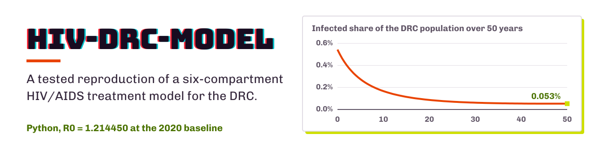
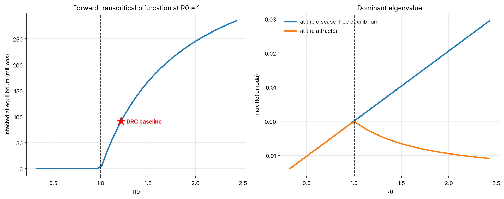
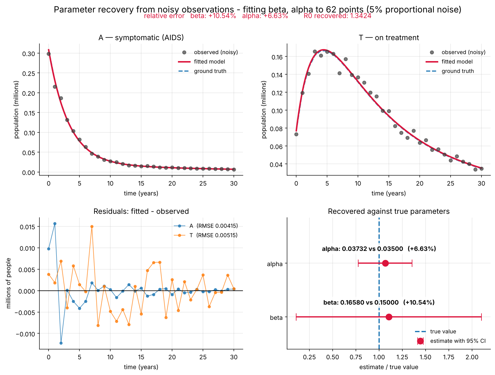
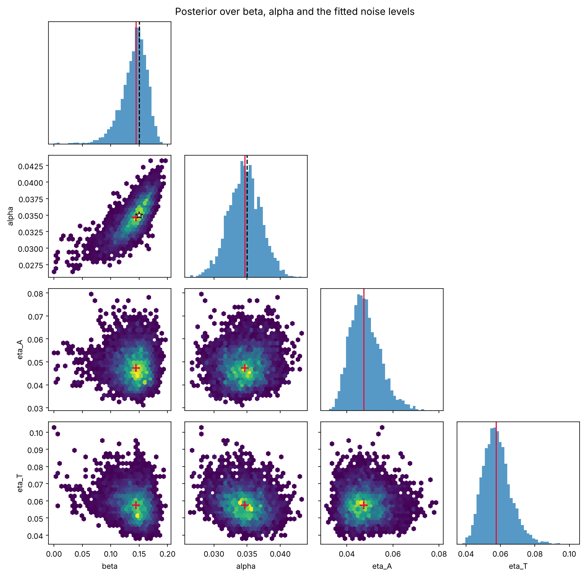
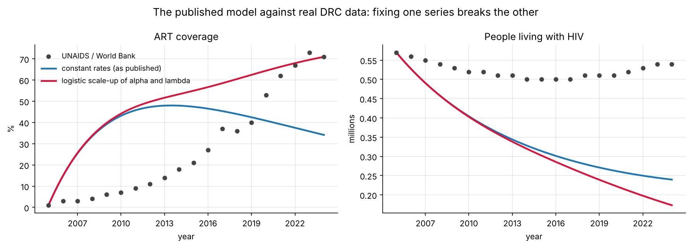

<p align="center">
  <picture><source media="(prefers-color-scheme: dark)" srcset="assets/banner-dark.svg"></picture>
</p>

# Hiv-Drc-Model

[English](README.md) · **繁體中文**

**[▶ 線上試用互動儀表板](https://hiv-drc-model-6h4eabztaookr4gj4steeg.streamlit.app)**，不需要安裝。

> 含治療的 HIV/AIDS 傳播動態：剛果民主共和國（DRC）案例的完整重現，並把模型倒過來求解。

[](https://www.python.org/)
[](LICENSE)
[](https://github.com/heinricitorgau/hiv-drc-model/actions/workflows/ci.yml)
[](https://doi.org/10.5556/j.tkjm.57.5817.2026)
[](https://doi.org/10.5281/zenodo.24274982)
[](https://hiv-drc-model-6h4eabztaookr4gj4steeg.streamlit.app)
[](https://colab.research.google.com/github/heinricitorgau/hiv-drc-model/blob/main/notebooks/01_inverse_problem.ipynb)

這是下面這篇論文中六倉室 HIV/AIDS 治療模型的完整、有測試的重現：

> C. K. Mbayi, J.-M. N. Mpompi and J. B. Munyakazi,
> *A model of HIV/AIDS transmission dynamics with treatment: The case of the DRC*,
> **Tamkang Journal of Mathematics** 57(2), 149–169 (2026).
> [doi:10.5556/j.tkjm.57.5817.2026](https://doi.org/10.5556/j.tkjm.57.5817.2026)

論文解的是正向問題：輸入速率，輸出軌跡。但接觸率 $\beta$ 和治療率 $\alpha$ 不是任何人量得到的量。所以這個套件也解**反問題**：從監測系統實際發布的含噪數字，找回隱藏的速率；接著再把模型拿去對照 UNAIDS 的真實資料，看它撐不撐得住。結果是撐不住，而套件會把這件事講清楚。

---

## 結果一覽

### 1. 論文數值重現到小數點後六位

$R_0 = 1.214450$，閉式解與 $FV^{-1}$ 的譜半徑一致，論文發表值為 1.2145。局部穩定性定理在閾值兩側都以數值驗證，模型在此呈現正向跨臨界分岔。

<p align="center"></p>

### 2. 把模型倒過來跑，找回隱藏的速率

只給兩個倉室的含噪觀測，有界非線性最小平方法就能找回 $\beta$ 和 $\alpha$，95% 區間涵蓋真值；在 5% 噪音下重複 40 次，覆蓋率正好是 95%。

<p align="center"></p>

### 3. 貝氏方法的區間更窄，而且自己推論噪音水準

系集 MCMC 取樣器（`emcee`）探索真正的後驗分布，並把每個序列的量測噪音和流行病學速率一起推論。在 10% 噪音下重複 20 次，與最小平方法相比：覆蓋率相同，區間窄 2 到 4 倍。

<p align="center"></p>

### 4. 面對真實資料，論文模型失靈了，而且失靈程度量得出來

- Table 2 標示為 DRC 2020，但它的治療倉室對應 **15.9% 的 ART 覆蓋率**，而 UNAIDS 當年的數字是 **53%**；15.9% 其實是 DRC 2013 年的水準。
- 用同一組真實序列的不同期間擬合，$\alpha$ 跑遍整個允許範圍，$R_0$ 從 0.49 到 6.23，正好橫跨論文討論的那個閾值。
- 讓速率走 logistic 擴大，2024 年 ART 覆蓋率幾乎完全對上（70.9% 對 71%），但 HIV 感染者人數卻差了三倍（0.173 百萬對 0.540 百萬）。

<p align="center"></p>

這是模型設定錯誤（misspecification），不是最佳化器不好。[完整報告](docs/REPORT.zh-TW.md#面對真實資料)逐個期間量測了這件事（也可以在[線上儀表板](https://hiv-drc-model-6h4eabztaookr4gj4steeg.streamlit.app)的第三個分頁自己切換 logistic 擴大看看）；[資訊性先驗那一節](docs/REPORT.zh-TW.md#資訊性先驗以及它們是否名副其實)則顯示九個擴大期參數中有三個只是先驗的回音，並不是資料決定的。

---

## 裡面有什麼

- **六倉室 ODE 系統**，用 `solve_ivp` 積分，以人口守恆恆等式驗證，並在三種求解器之間交叉比對。
- **$R_0$、平衡點與穩定性**，Jacobian 用 complex-step 微分，精度達機器精度。
- **局部與全域敏感度分析**（正規化指標、Latin hypercube + PRCC）。
- **合成資料產生器**，有兩種高斯量測誤差模型，讓估計器在已知正確答案的資料上開發。
- **最小平方法與 MCMC** 解反問題，附區間、相關矩陣、split-$\hat R$ 與後驗預測檢查。
- **觀測算子**，對應監測系統實際報告的數字（PLHIV、ART 覆蓋率），並實際量測[哪些資料值得收集](docs/REPORT.zh-TW.md#哪些資料值得收集)。
- **真實資料匯入**，來自 commit 進來的 UNAIDS／世界銀行快照，所以每次擬合都能重現。
- **隨時間變化的速率**；一旦啟用，常係數理論會拒絕回答，而不是給出誤導的答案。
- **互動式 Streamlit 儀表板**，把以上所有東西放到滑桿後面。
- **222 個測試**（含 doctest 共 238 個），沒有一個是拿程式碼和它自己比較。

---

## 快速開始

```bash
git clone https://github.com/heinricitorgau/hiv-drc-model.git
cd hiv-drc-model
pip install -e ".[app]"

python -m hiv_drc          # 十二張圖全部寫進 figures/，約 30 秒
streamlit run app.py       # 儀表板
```

不想安裝的話，[儀表板可以直接線上使用](https://hiv-drc-model-6h4eabztaookr4gj4steeg.streamlit.app)，兩個 notebook 也能在 Colab 開啟：
[反問題](https://colab.research.google.com/github/heinricitorgau/hiv-drc-model/blob/main/notebooks/01_inverse_problem.ipynb) ·
[貝氏不確定性](https://colab.research.google.com/github/heinricitorgau/hiv-drc-model/blob/main/notebooks/02_bayesian_uncertainty.ipynb)。

---

## 文件

| | |
| --- | --- |
| [**完整分析報告**](docs/REPORT.zh-TW.md) | 模型、$R_0$、每一項結果（包括負面結果），以及各自如何測試 |
| [**安裝與使用**](docs/USAGE.zh-TW.md) | 命令列、Python API、儀表板、十二張輸出圖、專案結構 |
| [Notebook 1](notebooks/01_inverse_problem.ipynb) | 估計流程的解說導覽（英文） |
| [Notebook 2](notebooks/02_bayesian_uncertainty.ipynb) | 同一個擬合改用 MCMC，以及兩種方法在哪裡不一致（英文） |
| [貢獻指南](CONTRIBUTING.md) | 如何提出修改，以及這裡怎樣才算一個測試 |

---

## 引用

如果你使用這份程式碼，請引用原論文：

```bibtex
@article{Mbayi2026HIVDRC,
  author  = {Mbayi, Charles K. and Mpompi, Jean-Marie N. and Munyakazi, Justin B.},
  title   = {A model of {HIV/AIDS} transmission dynamics with treatment:
             The case of the {DRC}},
  journal = {Tamkang Journal of Mathematics},
  volume  = {57},
  number  = {2},
  pages   = {149--169},
  year    = {2026},
  doi     = {10.5556/j.tkjm.57.5817.2026}
}
```

如果也要引用這份實作，請使用 GitHub 側欄的 **Cite this repository** 按鈕，它讀取的是 [`CITATION.cff`](CITATION.cff)。每個版本都會存檔到 Zenodo，[doi:10.5281/zenodo.24274982](https://doi.org/10.5281/zenodo.24274982) 永遠指向最新版。

這個 repository 是獨立的重現，與原作者沒有關聯；程式碼中的任何錯誤都是這份實作的問題，而不是論文的問題。

## 授權

[MIT](LICENSE)。論文本身仍依其出版者的條款授權。
